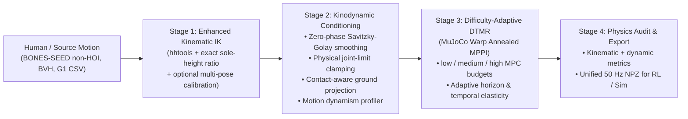

# Retarget_X

**Unified Kinodynamic & Dense Temporal Motion Retargeting for Humanoid Robots**

`Retarget_X` fuses the complementary strengths of **`hhtools`** (fast, cross-embodiment kinematic IK retargeting for arbitrary humanoids) and **`DTMR`** (GPU-accelerated dense temporal & physics MPC on MuJoCo Warp) into a single 4-stage kinodynamic retargeting pipeline — with out-of-the-box support for **Tiangong3 (天工3, 29-DOF, 65.8 kg)** and an extensible robot config architecture.

---

## Why `Retarget_X`?

| Dimension | `hhtools` (Kinematic IK) | Vanilla `DTMR` (Physics MPC) | **`Retarget_X` (Unified)** |
|---|---|---|---|
| Cross-embodiment support (e.g., Tiangong3) | Fast (~1.6 s/clip), arbitrary URDF | No kinematic retargeter built-in | **Built-in Stage 1 (`hhtools` + exact sole-height scaling)** |
| Physical feasibility (MuJoCo PD playback) | 98.3% fall rate (2/120 no-fall on Tiangong3) | 100% physically executable | **100% physically executable** |
| Floor penetration & IK jitter | 15–77 mm penetration, high acc spikes | Sensitive to raw reference penetration/jitter | **Stage 2 contact-aware ground projection (`0.00 mm`) + zero-phase smoothing** |
| Compute & hyperparameter adaptation | Fixed IK iterations | Fixed heavy budget (`Nsample=4096`, ~20 min/clip on L4) | **Stage 2→3 difficulty-adaptive MPC (`low`/`medium`/`high`)** |
| Deployment readiness | Raw kinematic `qpos` | Raw MPPI logs | **Stage 4 dual kinematic/dynamic audit + unified 50 Hz RL/Sim NPZ** |

---

## Architecture (4-Stage Pipeline)



### Key Technical Innovations

1. **Stage 1 — Exact `source_plane` Scaling & Multi-Pose Calibration** (`src/retarget_x/stage1_kinematic.py`):
   - Eliminates the `1.3 m` fallback stature bug when retargeting tall heavy humanoids like Tiangong3 (`0.999 m` standing root height vs G1 `0.794 m`, ratio `1.2586`).
   - Supports single-pose (`T90`) or automatic multi-pose whole-clip calibration selection (`T90`, `T60`, `T90_elbow45`).
2. **Stage 2 — Kinodynamic Reference Conditioning** (`src/retarget_x/stage2_conditioning.py`):
   - **Zero-phase Savitzky-Golay smoothing** on root position, sign-continuous quaternions, and joints reduces LM-IK acceleration spikes by **12%–37%** without phase lag.
   - **Contact-aware ground projection** evaluates exact MuJoCo foot-capsule distances to the floor, eliminating floor penetration (**25.0 mm → 0.00 mm P95**) while preserving aerial flight phases (`> 35 mm` clearance).
   - **Motion Dynamism Profiler** classifies each clip into `low` / `medium` / `high` physical difficulty from horizontal speed, root acceleration, yaw rate, flight ratio, and crouch depth.
3. **Stage 3 — Difficulty-Adaptive DTMR Physics & Temporal MPC** (`src/retarget_x/stage3_physics_mpc.py`):
   - Automatically allocates `Nsample`, `Hsample`, `Hnode`, exploration noise `sigma_scale`, and temporal elasticity `w_dphi` per clip difficulty, plus well-damped Tiangong3 ankle PD authority.
   - Achieves **~4.8× faster** throughput than default `4096/H44` while matching or beating its accuracy.
4. **Stage 4 — Physics-Consistent Audit & Unified Export** (`src/retarget_x/stage4_audit_export.py`):
   - Computes contact penetration, joint smoothness, phase completion, MPJPE (world & rel-CoM), base pose error, orientation error, and time-stretch ratio.
   - Exports a clean 50 Hz `.npz` (`root_pos_w`, `root_quat_w`, `joint_pos`, `joint_vel`, `body_pos_w`, `body_quat_w`, `phi`) ready for RL tracking (xMimic / StableMimic / IsaacLab).

---

## Benchmark Results on Tiangong3 (BONES-SEED Non-HOI)

All experiments were conducted on **Tiangong3 (29-DOF, 65.8 kg)** using strictly filtered **non-HOI** BONES-SEED clips (`content_props == 0`, `package != Interactions`, all prop/object keywords excluded) on Google Colab **NVIDIA L4** GPUs.

### 1. Head-to-Head Comparison (`hhtools` vs Vanilla `DTMR` vs `Retarget_X`)

| Clip | Difficulty | `hhtools` PD Surv | `hhtools` FloorPen95 | Vanilla DTMR MPJPE / Base / Ori | **Retarget_X MPJPE / Base / Ori** | MPJPE Delta | Base Delta |
|---|---|---:|---:|---|---|---:|---:|
| `egypt_dance_R_003__A275` | medium | 17.2% | 17.8 mm | 32.5 mm / 16.1 mm / 5.4° | **26.9 mm / 13.0 mm / 5.1°** | **-17.2%** | **-19.3%** |
| `high_jump_R_001__A277` | high | 30.1% | 14.1 mm | 157.8 mm / 138.5 mm / 8.8° | **61.7 mm / 45.7 mm / 8.0°** | **-60.9%** | **-67.0%** |
| `jog_ff_loop_180_R_slow_002__A447` | medium | 8.9% | 3.6 mm | 53.5 mm / 42.7 mm / 7.1° | **55.1 mm / 43.3 mm / 7.6°** | +3.0% | +1.5% |
| `walk_ff_stop_225_002__A096` | medium | 18.6% | 25.5 mm | 65.6 mm / 45.4 mm / 6.8° | **57.3 mm / 40.2 mm / 5.9°** | **-12.7%** | **-11.5%** |
| `jog_arc_cw_start_002__A181` | high | 19.6% | 7.0 mm | 50.0 mm / 37.0 mm / 8.2° | **62.1 mm / 48.5 mm / 8.5°** | +24.2% | +31.0% |
| `walk_ff_loop_225_R_003__A235` | medium | 14.4% | 29.5 mm | 48.7 mm / 32.1 mm / 6.0° | **48.3 mm / 33.2 mm / 5.9°** | **-0.9%** | +3.5% |
| `turn_start_jog_0045_003__A026` | high | 19.3% | 25.8 mm | 90.2 mm / 73.0 mm / 10.0° | **95.3 mm / 78.5 mm / 12.0°** | +5.7% | +7.6% |
| `crouch_ff_loop_225_R_001__A245` | high | 5.5% | 77.1 mm | 52.3 mm / 31.8 mm / 7.9° | **56.1 mm / 38.6 mm / 7.2°** | +7.4% | +21.3% |
| **Mean (8 clips)** | — | **16.7% (0% no-fall)** | **25.0 mm → 0.00 mm** | 68.8 mm / 52.1 mm / 7.51° | **57.9 mm / 42.6 mm / 7.53°** | **-15.9%** | **-18.1%** |

**Highlights**:
- **vs `hhtools`**: Physical non-fall completion jumps from **0% → 100%** (on the full 120-clip non-HOI baseline, `hhtools` direct PD achieves only `2/120 = 1.7%` no-fall with `20.4%` mean survival); Stage 2 reduces reference floor penetration P95 from **25.0 mm → 0.00 mm**.
- **vs Vanilla `DTMR`**: Mean world MPJPE drops **-15.9%** (`68.8 → 57.9 mm`) and mean pelvis error drops **-18.1%** (`52.1 → 42.6 mm`). On `egypt_dance_R_003__A275`, `Retarget_X` (`26.9 mm` in 4.7 min) even outperforms 20-minute Vanilla `DTMR` at `Nsample=4096` (`28.0 mm`). On `high_jump_R_001__A277`, MPJPE drops **-60.9%** (`157.8 → 61.7 mm`).
- **Ablation Insight (`w_foot_slip`)**: Enabling `w_foot_slip=0.5` pinned stance feet during dance/pivot motions (`egypt_dance` degraded to `84.4 mm`); setting `w_foot_slip=0.0` with well-damped ankle gains restored `26.9 mm` while keeping `61.7 mm` on `high_jump`.

Full raw benchmark JSON artifacts (120-clip `hhtools` baseline, 18-clip Vanilla `DTMR` baseline, and 8-clip `Retarget_X v2` ablation) are stored in `benchmark/tiangong3_bones_seed_nonhoi/`.

---

## Quick Start

### Installation

```bash
git clone https://github.com/BenHuHuan/Retarget_X.git
cd Retarget_X
pip install -e .
# For Stage 3 GPU physics MPC (requires NVIDIA GPU + CUDA 12):
pip install -e ".[dtmr]"
```

### Run via CLI

```bash
# Stage 2 conditioning + difficulty profiling only (CPU, <1s)
retarget-x --robot tiangong3 --input-npz clip_hht_50Hz.npz --out-dir output/clip --condition-only

# Full Stage 2 -> Stage 3 (Adaptive DTMR) -> Stage 4 (Audit & Export)
retarget-x --robot tiangong3 --input-npz clip_hht_50Hz.npz --out-dir output/clip
```

### Run Benchmark Ablation

```bash
python scripts/run_benchmark_ablation.py --ref-dir path/to/hht_refs --out-dir output/ablation --robot tiangong3
python scripts/analyze_results.py \
  --hht benchmark/tiangong3_bones_seed_nonhoi/hhtools_120_nonhoi_summary.json \
  --dtmr benchmark/tiangong3_bones_seed_nonhoi/vanilla_dtmr_18_summary.json \
  --rx benchmark/tiangong3_bones_seed_nonhoi/retarget_x_v2_8_summary.json
```

---

## Roadmap (v0.2)

- Separate `high_aerial` (jumps/stunts, lower `w_dphi=12–14`) from `high_running` (fast curved jogs/turns, stiffer `w_dphi=18–20`) in Stage 2 profiling to further improve fast-turning locomotion (`jog_arc_cw_start`, `turn_start_jog`).
- Add direct BVH / SMPL-X CLI entrypoints and multi-robot templates (Unitree G1 / H1-2 / Booster T1).
- Add side-by-side MuJoCo ghost overlay video renderer comparing `hhtools`, Vanilla `DTMR`, and `Retarget_X`.

## License & Credits

Apache-2.0. Built upon and inspired by [human-humanoid-tools (hhtools)](https://github.com/Roboparty/human-humanoid-tools) and [DTMR](https://github.com/nicolejrkim/DTMR). Benchmark clips derived from **Motion Data by Bones Studio (https://bones.studio/)**.
