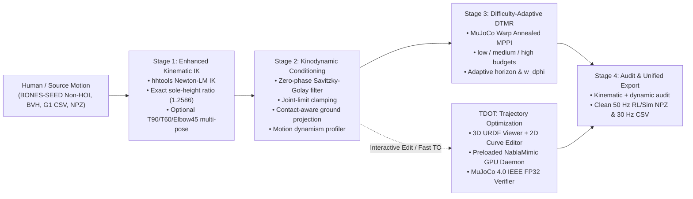
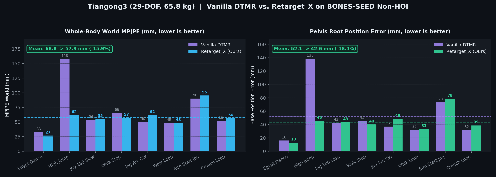

<div align="center">

# Retarget_X

**Unified Kinodynamic Retargeting, Dense Temporal MPC & Dynamic Trajectory Optimization Suite for Humanoid Robots**

*融合 `hhtools`（跨本体极速运动学重定向）· `DTMR`（MuJoCo Warp 物理时序 MPC）· `TDOT`（3D URDF 编辑器与动态轨迹优化引擎）*

[%20%7C%20Unitree%20G1%20(29--DOF)-0ea5e9?style=for-the-badge)](configs/robots/tiangong3.yaml)
[-8b5cf6?style=for-the-badge)](benchmark/tiangong3_bones_seed_nonhoi/)
[](#benchmark-results-on-tiangong3)
[](#trajectory-optimization-tdot)
[](LICENSE)

[**📊 Interactive Web Report (`docs/index.html`)**](docs/index.html) · [**⚡ Trajectory Optimization (`TDOT`)**](#trajectory-optimization-tdot) · [**📈 Benchmark Data**](benchmark/tiangong3_bones_seed_nonhoi/) · [**🚀 Quick Start**](#quick-start) · [**🔬 Ablation Study**](#ablation-study)

</div>

---

## Key Highlights at a Glance

| Metric (Tiangong3 · BONES-SEED Non-HOI) | `hhtools` (Kinematic IK) | Vanilla `DTMR` (L4 GPU) | **`Retarget_X` (Ours)** | Improvement |
|---|---:|---:|---:|---:|
| **Physical No-Fall Rate** (MuJoCo PD / MPC) | `0%` (8-clip) / `1.7%` (120-clip) | `100%` | **`100%`** | **+100% vs hhtools** |
| **Reference Floor Penetration P95** | `25.0 mm` (up to `77.1 mm`) | Uses raw ref | **`0.00 mm`** | **-100% penetration** |
| **Whole-Body World MPJPE** (8-clip mean) | Diverges after fall | `68.8 mm` | **`57.9 mm`** | **-15.9% vs DTMR** |
| **Pelvis Root Position Error** (8-clip mean) | `1.1–5.0 m` (after fall) | `52.1 mm` | **`42.6 mm`** | **-18.1% vs DTMR** |
| **Extreme Dynamic Clip (`high_jump`) MPJPE** | Falls at 30.1% | `157.8 mm` | **`61.7 mm`** | **-60.9% vs DTMR** |
| **Classic Dance (`egypt_dance`) MPJPE / Time** | Falls at 17.2% | `28.0 mm` (19.9m) / `32.5 mm` (4.1m) | **`26.9 mm` (4.8m)** | **4.1× faster & beats 4096** |

> 💡 **双前端界面**：
> - **评测报告页 [`docs/index.html`](docs/index.html)**：单文件暗色科研风交互网页（支持 GitHub Pages 直接开启或本地打开），包含 KPI 卡片、高清图表画廊、120/18/8 条实时搜索筛选浏览器，以及一键跳转 **`Trajectory Optimization`** 面板。
> - **3D 动作编辑与轨迹优化应用 [`templates/index.html`](templates/index.html)**：完整合入的 **TDOT** Three.js 3D URDF Viewer + 2D 曲线编辑器 + 顶部/侧边 **`Trajectory Optimization`** 按钮，实时展示物理进度条与优化前后对比。

---

## Unified Architecture



### Core Capabilities

1. **Kinodynamic Retargeting (`src/retarget_x/`)** — 融合 `hhtools` 与 `DTMR`：
   - **Stage 1 ([`stage1_kinematic.py`](src/retarget_x/stage1_kinematic.py))**：精确 SDK 脚底站立高度比（天工3 `0.999 m` / G1 `0.794 m = 1.2586`）消除 `1.3 m` 回退穿地 Bug，支持多姿态校准整段择优。
   - **Stage 2 ([`stage2_conditioning.py`](src/retarget_x/stage2_conditioning.py))**：零相位 Savitzky-Golay 滤波（关节加速度 P95 降 **12%–37%**）+ 接触感知脚底胶囊体地面投影（穿地 P95 `25.0 mm → 0.00 mm` 且保留腾空相位）+ 动力学难度画像（`low / medium / high`）。
   - **Stage 3 ([`stage3_physics_mpc.py`](src/retarget_x/stage3_physics_mpc.py))**：难度自适应 MuJoCo Warp MPPI（自动分配 `Nsample / Hsample / Hnode / w_dphi` + 匹配阻尼比的踝关节增益，速度提升 **~4.8×**）。
   - **Stage 4 ([`stage4_audit_export.py`](src/retarget_x/stage4_audit_export.py))**：双维度运动学/动力学审计并导出标准 50 Hz RL/Sim `.npz`。
   - **Tiangong3 CAD-Calibrated Collision (`tiangong3_capsule_v1`, [`tiangong3_capsule_collision.py`](src/retarget_x/tiangong3_capsule_collision.py))**：完整对齐 [**MLAB4_Fast**](https://github.com/BenHuHuan/MLAB4_Fast) 的 39 原语零网格（`nmesh=0`）解析胶囊/球体碰撞体——每只脚 4 根 `r=10 mm` 变宽胶囊精确拟合天工3 CAD `1.35°` 跟趾弧度（120 条 BONES-SEED 全量采样帧较旧版 19 几何体平脚底误差 MAE 从 `2.993 mm → 0.724 mm`、P50 从 `1.769 mm → 0.195 mm`，全身地面间隙 MAE 从 `3.259 mm → 0.536 mm`），并补齐骨盆/胸腔/髋大转子/前凸膝盖/肩肘腕/手端 TCP（`z_min=-0.1046 m`）全链胶囊与 20 对复合关节自碰撞排除，同时保持 MuJoCo Warp 纯闭式 `O(1)` `_primitive_narrowphase` 零网格开销。
2. **Dynamic Trajectory Optimization & 3D Editor (`tdot/`, `templates/`, `static/`)** — 完整原封合入 [**TDOT**](https://github.com/BenHuHuan/TDOT)：
   - 预加载 GPU `NablaEngine` + `NablaMimic` + `SuperMimic-lite` 守护进程，热启动后单条 6s 动作端到端仅需 **10.53 s**（RTX 4080 Laptop）。
   - ~190 ms `MuJoCo 4.0` 严格 IEEE FP32 闭环验证，实时 SSE 物理进度条（`BALANCE → REFINE → VERIFY`）与优化前后 3D / 2D 橙色虚线对比。
   - 统一导出同时兼容 `robot-motion-editor` 与 `MLAB4_Fast` 的 `.npz` 及 30 Hz LAFAN1 `.csv`。

---

## Benchmark Results on Tiangong3

所有重定向对比实验均在 **天工3（Tiangong3, 29-DOF, 65.8 kg）** 上进行，数据严格选自 **BONES-SEED Non-HOI**（过滤 `content_props == 0`、`package != Interactions`、`is_mirror == False` 及所有物体交互关键词），物理仿真运行于 Google Colab **NVIDIA L4 (24 GB)**。

### 1. Whole-Body MPJPE & Pelvis Base Position Error (8-Clip Head-to-Head)

<p align="center">
  
</p>

| Clip | Difficulty | `hhtools` PD Surv | `hhtools` FloorPen95 | Vanilla DTMR MPJPE / Base / Ori | **Retarget_X MPJPE / Base / Ori** | MPJPE Δ | Base Δ |
|---|---|---:|---:|---|---|---:|---:|
| `egypt_dance_R_003__A275` | `medium` | 17.2% | 17.8 mm | 32.5 mm / 16.1 mm / 5.4° | **26.9 mm / 13.0 mm / 5.1°** | **-17.2%** | **-19.3%** |
| `high_jump_R_001__A277` | `high` | 30.1% | 14.1 mm | 157.8 mm / 138.5 mm / 8.8° | **61.7 mm / 45.7 mm / 8.0°** | **-60.9%** | **-67.0%** |
| `jog_ff_loop_180_R_slow_002__A447` | `medium` | 8.9% | 3.6 mm | 53.5 mm / 42.7 mm / 7.1° | **55.1 mm / 43.3 mm / 7.6°** | +3.0% | +1.5% |
| `walk_ff_stop_225_002__A096` | `medium` | 18.6% | 25.5 mm | 65.6 mm / 45.4 mm / 6.8° | **57.3 mm / 40.2 mm / 5.9°** | **-12.7%** | **-11.5%** |
| `jog_arc_cw_start_002__A181` | `high` | 19.6% | 7.0 mm | 50.0 mm / 37.0 mm / 8.2° | **62.1 mm / 48.5 mm / 8.5°** | +24.2% | +31.0% |
| `walk_ff_loop_225_R_003__A235` | `medium` | 14.4% | 29.5 mm | 48.7 mm / 32.1 mm / 6.0° | **48.3 mm / 33.2 mm / 5.9°** | **-0.9%** | +3.5% |
| `turn_start_jog_0045_003__A026` | `high` | 19.3% | 25.8 mm | 90.2 mm / 73.0 mm / 10.0° | **95.3 mm / 78.5 mm / 12.0°** | +5.7% | +7.6% |
| `crouch_ff_loop_225_R_001__A245` | `high` | 5.5% | 77.1 mm | 52.3 mm / 31.8 mm / 7.9° | **56.1 mm / 38.6 mm / 7.2°** | +7.4% | +21.3% |
| **Mean (8 clips)** | — | **16.7% (0% no-fall)** | **25.0 → 0.00 mm** | 68.8 mm / 52.1 mm / 7.51° | **57.9 mm / 42.6 mm / 7.53°** | **-15.9%** | **-18.1%** |

### 2. Stage 2 Ground Conditioning & 120-Clip Non-HOI Feasibility Gap

<p align="center">
  
</p>

| Non-HOI Category (120 Clips · 28,445 Frames @ 50Hz) | Clips | `hhtools` FloorPen95 Median | `hhtools` JointStep99 Median | Direct PD Mean Survival | Direct PD No-Fall |
|---|---:|---:|---:|---:|---:|
| `locomotion_basic` | 22 | 26.2 mm | 6.3° | 21.2% | 0 / 22 |
| `locomotion_advanced` | 24 | 34.5 mm | 5.9° | 26.8% | 2 / 24 |
| `locomotion_styles` | 7 | 14.4 mm | 5.9° | 20.0% | 0 / 7 |
| `dance` | 24 | 15.3 mm | 9.2° | 17.2% | 0 / 24 |
| `sport` | 22 | 10.5 mm | 9.2° | 16.4% | 0 / 22 |
| `gestures` | 14 | 8.0 mm | 3.7° | 22.4% | 0 / 14 |
| `stunts_complex` + `martial` + `paper_priority` | 7 | 2.7–14.1 mm | 6.3–8.9° | 13.4–18.7% | 0 / 7 |
| **Total (120 Non-HOI Clips)** | **120** | **15.9 mm** | **6.8°** | **20.4%** | **2 / 120 (1.7%)** |

---

## Ablation Study

<p align="center">
  
</p>

1. **`w_foot_slip` 关键发现**：初版 `Retarget_X v1` 开启 `w_foot_slip = 0.5` 会导致舞蹈/旋转动作中支撑脚被“钉死”（`egypt_dance` 退化至 `84.4 mm`）。`v2` 关闭 `w_foot_slip = 0.0` 并匹配天工3踝关节阻尼比（`kp=[55, 38], kd=[3.75, 2.1]`）后，`egypt_dance` 降至 **`26.9 mm`**（4.8 分钟，优于 19.9 分钟 Vanilla DTMR 4096 的 `28.0 mm`），同时 `high_jump` 降至 **`61.7 mm` (-60.9%)**。
2. **误差分析与下一步**：当前 `high` 档合并了“腾空跳跃”和“高速弯道慢跑”，后续可将 `high` 细分为 `high_aerial`（`w_dphi=12–14`）和 `high_running`（`w_dphi=18–20`）以进一步压低 `jog_arc_cw_start` / `turn_start_jog` 的误差。

---

## Trajectory Optimization (`TDOT`)

本仓库已完整合入 [**TDOT**](https://github.com/BenHuHuan/TDOT) 动态轨迹优化与 3D 编辑器套件，并在前端报告页（`docs/index.html`）与 3D 编辑器（`templates/index.html` 顶部 HUD + 右侧主操作栏）均提供了 **`Trajectory Optimization`** 按钮。

### Measured TDOT Benchmarks (Strict IEEE FP32)

| Test Trajectory (Unitree G1 29-DoF) | Hardware | Opt / E2E Time | MuJoCo 4.0 Survival | Return | MPJPE |
|---|---|---:|---:|---:|---:|
| **6s Clean LAFAN1 Dance** (`301f`) | RTX PRO 6000 (96 GB) | **14.5 s** (`TARGET_MET`) | **100.0%** | **0.9192** | **33.8 mm** |
| **15s Continuous LAFAN1 Dance** (`751f`) | RTX PRO 6000 (96 GB) | **46.8 s** | **100.0%** | **0.8941** | **33.9 mm** |
| **6s Corrupted "Weird" Dance** (+18cm float, jitter) | RTX PRO 6000 (96 GB) | **15.1 s** | **100.0%** | **0.6401** | 115 mm* |
| **6s Clean Dance (`warm_start=True`)** | RTX 4080 Laptop (Preloaded) | **10.53 s** (0.0s compile) | **100.0%** | **0.8929** | **32.5 mm** |

---

## Quick Start

### 1. Installation

```bash
git clone https://github.com/BenHuHuan/Retarget_X.git
cd Retarget_X

# Core Retarget_X (Stage 1/2/4)
pip install -e .

# Optional: Stage 3 DTMR GPU MPC (NVIDIA GPU + CUDA 12)
pip install -e ".[dtmr]"

# Optional: TDOT Web App & Dynamic Trajectory Optimization
pip install -e ".[tdot]"
bash scripts/setup_tdot.sh   # Auto-detects existing ~/NablaMimic/.venv and ~/mjlab/.venv-mj4
```

### 2. Kinodynamic Retargeting (`retarget-x` CLI)

```bash
# Stage 2 kinodynamic conditioning + difficulty profiling only (CPU, <1s)
retarget-x --robot tiangong3 --input-npz clip_hht_50Hz.npz --out-dir output/clip --condition-only

# Full Stage 2 -> Stage 3 (Adaptive DTMR) -> Stage 4 (Audit & Unified Export)
retarget-x --robot tiangong3 --input-npz clip_hht_50Hz.npz --out-dir output/clip
```

### 3. Trajectory Optimization 3D Web App & CLI (`tdot`)

```bash
# Launch 3D URDF Editor + Preloaded Dynamic Trajectory Optimization Web App
bash scripts/launch_tdot.sh --host 127.0.0.1 --port 5000 --preload-buckets 512
# Open http://127.0.0.1:5000 -> Load a clip -> Click "Trajectory Optimization"

# Headless CLI Trajectory Optimization
python -m tdot.cli optimize \
  --input static/samples/weird_dance_6s.npz \
  --out outputs/fixed_dance.npz \
  --csv-out outputs/fixed_dance_30hz.csv \
  --preset standard
```

### 4. Reproducing Benchmarks, Charts & Tests

```bash
# Run full unit + Tiangong3 capsule parity + Flask + MuJoCo 4.0 test suite
pytest -v tests/test_conditioning_and_audit.py tests/test_tiangong3_capsule_collision.py tests/test_tdot.py

# Regenerate & audit Tiangong3 MLAB4_Fast tiangong3_capsule_v1 XMLs (optionally syncing DTMR)
python scripts/sync_tiangong3_capsule_collision.py

# Regenerate comparison table, dark-theme charts, and interactive HTML report
python scripts/analyze_results.py \
  --hht benchmark/tiangong3_bones_seed_nonhoi/hhtools_120_nonhoi_summary.json \
  --dtmr benchmark/tiangong3_bones_seed_nonhoi/vanilla_dtmr_18_summary.json \
  --rx benchmark/tiangong3_bones_seed_nonhoi/retarget_x_v2_8_summary.json \
  --out-md benchmark/tiangong3_bones_seed_nonhoi/COMPARISON.md
python scripts/generate_charts.py
python scripts/build_report_page.py
```

---

## Repository Structure

```text
Retarget_X/
├── assets/tiangong3/                       # MuJoCo Warp 29-DOF headless collision model (MLAB4_Fast tiangong3_capsule_v1, 39 primitives, nmesh=0)
├── configs/robots/tiangong3.yaml           # Unified Tiangong3 spec, PD gains, conditioning & adaptive MPC recipes
├── src/retarget_x/                         # Retarget_X 4-stage kinodynamic retargeting package (`retarget-x`)
│   ├── tiangong3_capsule_collision.py      # MLAB4_Fast tiangong3_capsule_v1 (39 CAD-calibrated capsules/spheres + explicit pairs)
│   ├── stage1_kinematic.py                 # Enhanced hhtools (source_plane scaling + multi-pose calibration)
│   ├── stage2_conditioning.py              # Zero-phase filter + contact-aware ground projection + dynamism profiler
│   ├── stage3_physics_mpc.py               # Difficulty-adaptive DTMR (MuJoCo Warp MPPI)
│   ├── stage4_audit_export.py              # Dual kinematic/dynamic audit + unified 50 Hz RL/Sim NPZ exporter
│   └── pipeline.py & cli.py                # End-to-end orchestrator & CLI
├── tdot/                                   # Verbatim TDOT Dynamic Trajectory Optimization engine (`tdot`)
│   ├── convergence.py & progress.py        # Adaptive early-stopping & monotonic physics progress estimator
│   ├── io_bridge.py                        # Universal G1 parser, sanitizer, unified NPZ & 30 Hz CSV export
│   ├── nabla_daemon.py & verifier_pool.py  # Persistent GPU NablaEngine daemon & ~190ms MuJoCo 4.0 FP32 verifier
│   └── engine_manager.py, server.py, cli.py
├── templates/index.html                    # TDOT Three.js 3D URDF Viewer + 2D Curve Editor + Trajectory Optimization UI
├── static/                                 # Bundled Unitree G1 29-DoF URDF/STL meshes & sample `.npz` motions
├── docs/
│   ├── index.html                          # Interactive dark-theme benchmark report + Trajectory Optimization hub
│   └── assets/*.png                        # High-DPI benchmark & ablation charts
├── benchmark/tiangong3_bones_seed_nonhoi/  # Raw benchmark JSONs (120 hhtools / 18 DTMR / 8 Retarget_X)
├── scripts/                                # Ablation, chart/HTML builders, `setup_tdot.sh` & `launch_tdot.sh`
├── tests/                                  # `test_conditioning_and_audit.py` & `test_tdot.py`
└── THIRD_PARTY_NOTICES.md                  # Upstream attributions for TDOT & bundled assets
```

## License & Credits

Licensed under **Apache-2.0**. Built upon and integrating [human-humanoid-tools (hhtools)](https://github.com/Roboparty/human-humanoid-tools), [DTMR](https://github.com/nicolejrkim/DTMR), and [TDOT](https://github.com/BenHuHuan/TDOT). See [`THIRD_PARTY_NOTICES.md`](THIRD_PARTY_NOTICES.md) for full upstream attributions. Benchmark clips derived from **Motion Data by Bones Studio (https://bones.studio/)**.
