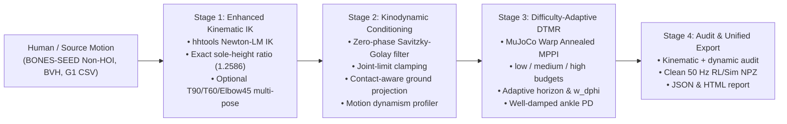
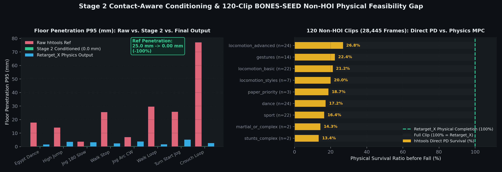
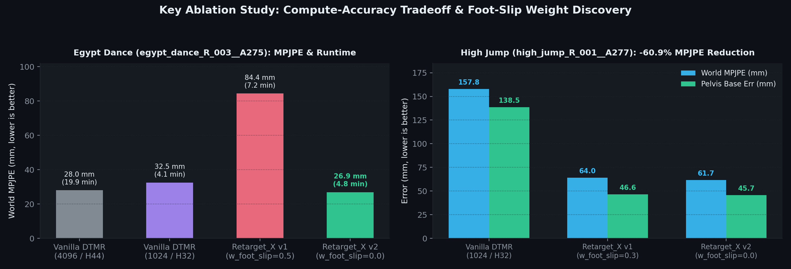

<div align="center">

# Retarget_X

**Unified Kinodynamic & Dense Temporal Motion Retargeting for Humanoid Robots**

*融合 `hhtools` 跨本体极速运动学重定向与 `DTMR` MuJoCo Warp 物理时序优化的下一代人形机器人重定向引擎*

[-0ea5e9?style=for-the-badge)](configs/robots/tiangong3.yaml)
[-8b5cf6?style=for-the-badge)](benchmark/tiangong3_bones_seed_nonhoi/)
[](#benchmark-results-on-tiangong3)
[-10b981?style=for-the-badge)](#benchmark-results-on-tiangong3)
[](LICENSE)

[**📊 Interactive Web Report (`docs/index.html`)**](docs/index.html) · [**📈 Benchmark Data**](benchmark/tiangong3_bones_seed_nonhoi/) · [**🚀 Quick Start**](#quick-start) · [**🔬 Ablation Study**](#ablation-study)

</div>

---

## Key Highlights at a Glance

| Metric (Tiangong3 · BONES-SEED Non-HOI) | `hhtools` (Kinematic IK) | Vanilla `DTMR` (L4 GPU) | **`Retarget_X` (Ours)** | Improvement |
|---|---:|---:|---:|---:|
| **Physical No-Fall Rate** (MuJoCo PD / MPC) | `0%` (8-clip) / `1.7%` (120-clip) | `100%` | **`100%`** | **+100% vs hhtools** |
| **Reference Floor Penetration P95** | `25.0 mm` (up to `77.1 mm`) | Uses raw ref | **`0.00 mm`** | **-100% penetration** |
| **Whole-Body World MPJPE** (8-clip mean) | Diverges after fall | `68.8 mm` | **`57.9 mm`** | **-15.9% vs DTMR** |
| **Pelvis Root Position Error** (8-clip mean) | `1.1–5.0 m` (after fall) | `52.1 mm` | **`42.6 mm`** | **-18.1% vs DTMR** |
| **Extreme Dynamic Clip (`high_jump`) MPJPE** | Falls at 30.1% | `157.8 mm` | **`61.7 mm`** | **-60.9% vs DTMR** |
| **Classic Dance (`egypt_dance`) MPJPE / Time** | Falls at 17.2% | `28.0 mm` (19.9m) / `32.5 mm` (4.1m) | **`26.9 mm` (4.8m)** | **4.1× faster & beats 4096** |

> 💡 **交互式前端评测报告**：仓库内置单文件暗色科研风交互网页 [`docs/index.html`](docs/index.html)（支持 GitHub Pages 直接开启，或本地浏览器直接打开），包含 KPI 概览卡片、高清图表画廊以及可实时搜索/筛选的 **8 条三方精测 / 18 条 Vanilla DTMR / 120 条 BONES-SEED Non-HOI** 完整数据浏览器。

---

## Architecture: 4-Stage Kinodynamic Pipeline



### Why Fuse `hhtools` and `DTMR`?

1. **`hhtools` 极快且通用，但缺乏物理可行性**：在 120 条非 HOI BONES-SEED 动作（28,445 帧 @ 50Hz）上平均仅需 `1.61 s/clip`，但在天工3真实 MuJoCo 动力学与 SDK-A PD 增益下直接回放，**118/120 (98.3%) 失衡跌倒**，平均仅能存活 20.4% 进度；同时存在 `15–77 mm` 地面穿透与高频 LM-IK 加速度毛刺。
2. **`DTMR` 物理极稳，但不做跨本体运动学且算力昂贵**：无法原生处理天工3，默认 `Nsample=4096, Hsample=44` 在 L4 GPU 上单条需 `~20 分钟`，且上游参考的穿地与抖动会直接拖垮高难动态动作（如 `high_jump` 误差达 `157.8 mm`）。
3. **`Retarget_X` 的核心创新（Stage 2 桥接层 + Stage 3 难度自适应）**：
   - **接触感知地面投影**（[`stage2_conditioning.py`](src/retarget_x/stage2_conditioning.py)）：基于天工3精确拟合的 6 根脚底胶囊体，逐帧消除地面穿透（`25.0 mm → 0.00 mm`）并完整保留腾空飞行相位（`> 35 mm` 离地高度）。
   - **保形零相位平滑**：Savitzky-Golay 零相位滤波（窗口 7 帧，3 阶）将关节加速度 P95 毛刺削减 **12%–37%**，且零相位滞后。
   - **动力学难度画像 + 自适应 MPC**（[`stage3_physics_mpc.py`](src/retarget_x/stage3_physics_mpc.py)）：按水平速度、加速度、腾空占比、偏航角速度与下蹲深度自动划分 `low / medium / high`，动态分配最优 `Nsample / Hsample / Hnode / w_dphi`，把计算效率提升 **~4.8×** 同时在难例上取得大幅精度飞跃。

---

## Benchmark Results on Tiangong3

所有实验均在 **天工3（Tiangong3, 29-DOF, 65.8 kg）** 上进行，数据严格选自 **BONES-SEED Non-HOI**（过滤条件：`content_props == 0`、`package != Interactions`、`is_mirror == False` 且排除所有含箱子/椅子/门/道具等物体交互词的动作），物理仿真全部运行于 Google Colab **NVIDIA L4 (24 GB)**。

### 1. Whole-Body MPJPE & Pelvis Base Position Error (8-Clip Head-to-Head)

<p align="center">
  
</p>

| Clip | Difficulty | `hhtools` PD Surv | `hhtools` FloorPen95 | Vanilla DTMR MPJPE / Base / Ori | **Retarget_X MPJPE / Base / Ori** | MPJPE Δ | Base Δ |
|---|---|---:|---:|---|---|---:|---:|
| `egypt_dance_R_003__A275` | `medium` | 17.2% | 17.8 mm | 32.5 mm / 16.1 mm / 5.4° | **26.9 mm / 13.0 mm / 5.1°** | **-17.2%** | **-19.3%** |
| `high_jump_R_001__A277` | `high` | 30.1% | 14.1 mm | 157.8 mm / 138.5 mm / 8.8° | **61.7 mm / 45.7 mm / 8.0°** | **-60.9%** | **-67.0%** |
| `jog_ff_loop_180_R_slow_002__A447` | `medium` | 8.9% | 3.6 mm | 53.5 mm / 42.7 mm / 7.1° | **55.1 mm / 43.3 mm / 7.6°** | +3.0% | +1.5% |
| `walk_ff_stop_225_002__A096` | `medium` | 18.6% | 25.5 mm | 65.6 mm / 45.4 mm / 6.8° | **57.3 mm / 40.2 mm / 5.9°** | **-12.7%** | **-11.5%** |
| `jog_arc_cw_start_002__A181` | `high` | 19.6% | 7.0 mm | 50.0 mm / 37.0 mm / 8.2° | **62.1 mm / 48.5 mm / 8.5°** | +24.2% | +31.0% |
| `walk_ff_loop_225_R_003__A235` | `medium` | 14.4% | 29.5 mm | 48.7 mm / 32.1 mm / 6.0° | **48.3 mm / 33.2 mm / 5.9°** | **-0.9%** | +3.5% |
| `turn_start_jog_0045_003__A026` | `high` | 19.3% | 25.8 mm | 90.2 mm / 73.0 mm / 10.0° | **95.3 mm / 78.5 mm / 12.0°** | +5.7% | +7.6% |
| `crouch_ff_loop_225_R_001__A245` | `high` | 5.5% | 77.1 mm | 52.3 mm / 31.8 mm / 7.9° | **56.1 mm / 38.6 mm / 7.2°** | +7.4% | +21.3% |
| **Mean (8 clips)** | — | **16.7% (0% no-fall)** | **25.0 → 0.00 mm** | 68.8 mm / 52.1 mm / 7.51° | **57.9 mm / 42.6 mm / 7.53°** | **-15.9%** | **-18.1%** |

### 2. Stage 2 Ground Conditioning & 120-Clip Non-HOI Feasibility Gap

<p align="center">
  
</p>

| Non-HOI Category (120 Clips · 28,445 Frames @ 50Hz) | Clips | `hhtools` FloorPen95 Median | `hhtools` JointStep99 Median | Direct PD Mean Survival | Direct PD No-Fall |
|---|---:|---:|---:|---:|---:|
| `locomotion_basic` | 22 | 26.2 mm | 6.3° | 21.2% | 0 / 22 |
| `locomotion_advanced` | 24 | 34.5 mm | 5.9° | 26.8% | 2 / 24 |
| `locomotion_styles` | 7 | 14.4 mm | 5.9° | 20.0% | 0 / 7 |
| `dance` | 24 | 15.3 mm | 9.2° | 17.2% | 0 / 24 |
| `sport` | 22 | 10.5 mm | 9.2° | 16.4% | 0 / 22 |
| `gestures` | 14 | 8.0 mm | 3.7° | 22.4% | 0 / 14 |
| `stunts_complex` + `martial` + `paper_priority` | 7 | 2.7–14.1 mm | 6.3–8.9° | 13.4–18.7% | 0 / 7 |
| **Total (120 Non-HOI Clips)** | **120** | **15.9 mm** | **6.8°** | **20.4%** | **2 / 120 (1.7%)** |

---

## Ablation Study

<p align="center">
  
</p>

1. **`w_foot_slip` 关键发现**：初版 `Retarget_X v1` 开启了 `w_foot_slip = 0.5`，导致舞蹈/原地旋转动作中支撑脚被过度“钉死”，骨盆无法跟上参考位移（`egypt_dance` 退化至 `84.4 mm`）。在 `v2` 中关闭 `w_foot_slip = 0.0` 并匹配天工3踝关节阻尼比（`kp=[55, 38], kd=[3.75, 2.1]`）后，`egypt_dance` 直接降至 **`26.9 mm`**（4.8 分钟，甚至优于 19.9 分钟的 Vanilla DTMR 4096 `28.0 mm`），同时 `high_jump` 进一步降至 **`61.7 mm` (-60.9%)**。
2. **误差分析与 v0.2 优化方向**：当前 `high` 档同时包含“腾空跳跃”和“高速弧线慢跑”，低 `w_dphi=14` 对腾空跳跃极度有利，但在非腾空的高速弯道跑（`jog_arc_cw_start`, `turn_start_jog`）上会允许轻微相位漂移。v0.2 将把 `high` 细分为 `high_aerial`（`w_dphi=12–14`）和 `high_running`（`w_dphi=18–20`）。

---

## Quick Start

### Installation

```bash
git clone https://github.com/BenHuHuan/Retarget_X.git
cd Retarget_X
pip install -e .

# Stage 3 GPU physics MPC (requires NVIDIA GPU + CUDA 12)
pip install -e ".[dtmr]"
```

### CLI Usage

```bash
# Stage 2 kinodynamic conditioning + difficulty profiling only (CPU, <1s)
retarget-x --robot tiangong3 --input-npz clip_hht_50Hz.npz --out-dir output/clip --condition-only

# Full Stage 2 -> Stage 3 (Adaptive DTMR) -> Stage 4 (Audit & Unified Export)
retarget-x --robot tiangong3 --input-npz clip_hht_50Hz.npz --out-dir output/clip
```

### Reproducing Benchmarks & Charts

```bash
# Run head-to-head ablation
python scripts/run_benchmark_ablation.py --ref-dir path/to/hht_refs --out-dir output/ablation --robot tiangong3

# Regenerate comparison table, dark-theme charts, and interactive HTML report
python scripts/analyze_results.py \
  --hht benchmark/tiangong3_bones_seed_nonhoi/hhtools_120_nonhoi_summary.json \
  --dtmr benchmark/tiangong3_bones_seed_nonhoi/vanilla_dtmr_18_summary.json \
  --rx benchmark/tiangong3_bones_seed_nonhoi/retarget_x_v2_8_summary.json \
  --out-md benchmark/tiangong3_bones_seed_nonhoi/COMPARISON.md
python scripts/generate_charts.py
python scripts/build_report_page.py
```

---

## Repository Structure

```text
Retarget_X/
├── assets/tiangong3/                  # MuJoCo Warp 29-DOF headless collision model (0.02mm sole accuracy)
├── configs/robots/tiangong3.yaml      # Unified robot spec, PD gains, conditioning & adaptive MPC recipes
├── src/retarget_x/
│   ├── stage1_kinematic.py            # Enhanced hhtools (source_plane scaling + multi-pose calibration)
│   ├── stage2_conditioning.py         # Zero-phase filter + contact-aware ground projection + dynamism profiler
│   ├── stage3_physics_mpc.py          # Difficulty-adaptive DTMR (MuJoCo Warp MPPI)
│   ├── stage4_audit_export.py         # Dual kinematic/dynamic audit + unified 50 Hz RL/Sim NPZ exporter
│   ├── pipeline.py & cli.py           # End-to-end orchestrator & `retarget-x` CLI
├── docs/
│   ├── index.html                     # Interactive dark-theme benchmark report (GitHub Pages ready)
│   └── assets/*.png                   # High-DPI benchmark & ablation charts
├── benchmark/tiangong3_bones_seed_nonhoi/  # Full raw JSON results (120 hhtools / 18 DTMR / 8 Retarget_X)
├── scripts/                           # Ablation runner, analyzer, chart & HTML report generators
└── tests/                             # Unit tests for Stage 2 conditioning and Stage 4 audit
```

## License & Credits

Apache-2.0. Built upon and inspired by [human-humanoid-tools (hhtools)](https://github.com/Roboparty/human-humanoid-tools) and [DTMR](https://github.com/nicolejrkim/DTMR). Benchmark clips derived from **Motion Data by Bones Studio (https://bones.studio/)**.
